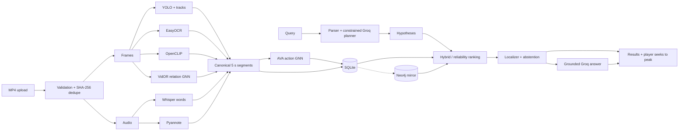

# VidQuery

VidQuery is an evidence-backed multimodal video search system. It turns an MP4
into timestamp-aligned evidence (speech, speakers, on-screen text, objects,
appearance, person actions, and subject-predicate-object relationships). Given
a natural-language query, it returns the moments that match, seeks to the exact
peak-evidence timestamp, and says how much the evidence can be trusted.

```text
Find where architecture is discussed
Find where SPEAKER_01 discusses deployment
Find a person near a laptop
Find the person in the blue jacket
Find a person talking to another person
find drive          <- ambiguous: the action, or the spoken word?
```

SQLite is the system of record and default search backend. Neo4j is an optional
graph mirror. Learned models run only from compatible, checksum-validated
checkpoints; random GNN weights are never used for inference.

## What it does

**Indexing.** Each upload is validated, deduplicated by SHA-256, split into
frames and audio, and passed through:

| Evidence | Model |
|---|---|
| Transcript with word timings | Whisper |
| Speaker turns | Pyannote 3.1 |
| Objects and short-range tracks | YOLOv8 |
| On-screen text | EasyOCR |
| Appearance descriptions | OpenCLIP ViT-B-32 |
| Geometry relations (`near`, `left_of`, `inside`, ...) | box geometry |
| Explicit relations (50 predicates) | VidOR pair-visual GATv2 |
| Person actions (80 labels) | AVA GATv2 |
| Semantic text vectors | MiniLM |

Everything is aligned into five-second canonical segments that keep every
underlying observation and its own timestamp.

**Search.** Search runs in two stages:

1. **Retrieve.** A local parser turns the query into a validated plan
   (entities, actions, relation tuples, speaker, spoken or OCR terms). The
   constrained Groq planner is consulted only for genuinely ambiguous queries.
   Segments are then ranked by lexical, semantic, entity, action, OCR,
   appearance, and exact relation-tuple evidence.
2. **Localize and assess** (Review-2).
   - **Localization.** Inside each winning segment, the localizer finds the
     peak-evidence moment (word, frame, or interval) instead of returning the
     segment start.
   - **Reliability.** Each result gets a reliability-weighted confidence and a
     `supported` / `weak` / `insufficient` verdict. Weak model output, such as
     the action GNN, cannot make a result look certain on its own.
   - **Hypotheses.** For ambiguous queries like `find drive`, each
     interpretation is retrieved separately. The system then either resolves
     the ambiguity or asks the user to pick one.
   - **Abstention.** When the evidence is insufficient, the response says so
     instead of returning a confident wrong timestamp.

**Answers.** Optionally, Groq writes a grounded answer from the top evidence,
citing only real result IDs and timestamps.



Groq never queries a database and never produces executable Cypher. If Groq is
unavailable, search still works.

## Quick start

Requirements: Python 3.11 or 3.12, FFmpeg/ffprobe, a Hugging Face token accepted
for Pyannote, and optionally a Groq API key and Docker (for Neo4j).

```bash
git clone https://github.com/0ri3nt/VidQuery.git
cd VidQuery
python3.12 -m venv .venv
source .venv/bin/activate            # Windows: .\.venv\Scripts\Activate.ps1
python -m pip install --upgrade pip
python -m pip install -e ".[dev,full]"
cp .env.example .env                 # Windows: Copy-Item .env.example .env
```

Put `HUGGINGFACE_TOKEN` and `GROQ_API_KEY` in `.env` (it is gitignored). For the
first run, set `ALLOW_MODEL_DOWNLOADS=true` and `HF_HUB_OFFLINE=0` so models can
be cached, then set them back.

```bash
python -m vidquery serve --host 127.0.0.1 --port 8000
```

Open <http://127.0.0.1:8000> (OpenAPI docs are at `/docs`), upload an MP4, and
search once it reaches `READY`. `GET /api/health` shows the readiness of every
model.

**[docs/SETUP.md](docs/SETUP.md)** has the exact model cache layout, how to
install the trained GNN checkpoints, and fixes for common problems (macOS SSL
certificate errors, Whisper on Apple Silicon, slow diarization, and a GNN that
produces no actions).

## Command line

| Command | Purpose |
|---|---|
| `serve` | run the API and browser UI |
| `process --video PATH --copy` | register and index one MP4 |
| `search "QUERY"` | search the local index |
| `refresh-library [--video-id ID]` | re-run current models on indexed videos |
| `diagnose-query "QUERY" [--video-id ID]` | trace why an action or relation query fails ([guide](docs/RETRIEVAL_DIAGNOSTICS.md)) |
| `evaluate` | run the Review-1 retrieval benchmark |
| `evaluate-challenge` | run the Review-2 timestamp and ambiguity benchmark |
| `backfill-gnn-actions` | apply the validated action GNN to stored evidence without reprocessing media |
| `import-ava`, `expand-ava-dataset` | import or expand the AVA evaluation and training corpus |
| `train-action-model`, `train-gnn-action-model` | train the action models |

All commands run as `python -m vidquery <command>`. Model changes do not rewrite
existing segments; use `refresh-library` or the Library tab's reprocess action.

## API

| Endpoint | Purpose |
|---|---|
| `POST /api/videos` | validate, stream, register, and queue an MP4 |
| `GET /api/videos` | list the video library |
| `GET /api/videos/{id}/status` | processing state, warnings, model provenance |
| `POST /api/videos/{id}/process` | reprocess (`409` while a job is running) |
| `POST /api/search` | ranked, localized evidence, with hypotheses, verdicts, and an optional grounded answer |
| `GET /api/videos/{id}/stream` | byte-range MP4 playback |
| `GET /api/videos/{id}/thumbnail` | nearest extracted frame |
| `GET /api/health` | SQLite, Neo4j, and per-model readiness |

Search accepts `ranking` (`hybrid` or `reliability`), `localize`,
`collapse_duplicate_evidence`, and `hypothesis_id`. The defaults reproduce
Review-1 behaviour; the UI turns on the full Review-2 behaviour. See
[docs/API.md](docs/API.md) and [docs/REVIEW2.md](docs/REVIEW2.md).

## Measured results

Two kinds of numbers appear below. **End-to-end** numbers come from videos
indexed only by the models. **Labelled-evidence** numbers come from an index
whose evidence was partly inserted from labels; they measure retrieval and
ranking, not end-to-end accuracy.

### End-to-end action benchmark (model-only)

AVA v2.2 movie windows (15 minutes each) were re-indexed from raw video by the
full pipeline, with no ground-truth import. Ground truth comes from official AVA
annotations. The table uses the **untouched** test set: three AVA validation
videos chosen by a fixed rule and queried in wording committed before the
parser was changed (41 positive, 15 negative queries).

| System (full Review-2 pipeline) | P@1 [95% CI] | Share of queries answered | Negatives rejected | AURC (lower better) |
|---|---:|---:|---:|---:|
| Original parser | 0.122 [0.02, 0.22] | 0.84 | 0.20 | 0.84 |
| Action lexicon parser | 0.268 [0.15, 0.41] | 0.77 | 0.20 | 0.64 |
| + leakage-free action GNN | 0.220 [0.10, 0.34] | 0.79 | 0.20 | 0.70 |
| + calibration-fitted priors and thresholds | 0.073 [0.00, 0.15] | 0.05 | 1.00 | 0.56 |

The parser fix is the only change with a significant effect (paired +0.146 P@1,
95% CI [0.024, 0.268]). The retrained action model is not measurably better.
Thresholds fitted on three calibration videos over-abstain on new videos.
Movie footage does not cover speech, OCR, or lecture queries. Details are in
[docs/EVALUATION_END_TO_END.md](docs/EVALUATION_END_TO_END.md) and
[docs/PROGRESS_2026-10-25.md](docs/PROGRESS_2026-10-25.md).

### Temporal localization and answerability (Charades-STA + NA-VMR, model-only)

300 Charades-STA test videos indexed end to end from raw video, with 863
human-written sentence queries plus 1,718 non-answerable NA-VMR queries
(863 in-domain, 855 out-of-domain). All settings were chosen on 150 separate
validation videos and test was run once. This benchmark measures moment
localization, not action recognition, so it is reported separately from the
AVA benchmark above.

| System (Review-2) | P@1 [95% CI] | R@1@0.5 | R@1@0.7 | R@5@0.5 | In-domain negatives rejected | Out-of-domain negatives rejected |
|---|---:|---:|---:|---:|---:|---:|
| Content-blind fixed window (from validation) | n/a | 0.269 | 0.092 | n/a | n/a | n/a |
| Default settings | 0.094 [0.08, 0.11] | 0.099 | 0.038 | 0.284 | 0.55 | 1.00 |
| Soft constraints + frame-level OpenCLIP similarity + 10 s spans | **0.414 [0.38, 0.45]** | **0.416** | **0.187** | **0.870** | 0.01 | 1.00 |

The selected settings beat the default by +0.318 R@1@0.5 (95% CI
[0.275, 0.362]) and the content-blind baseline by +0.147 ([0.094, 0.201]).
Out-of-domain negatives are rejected reliably. In-domain negatives
(plausible sentences about other Charades videos) are not separable by
confidence (AUROC 0.60). The default settings reject more of them only
because they also return nothing for 48% of positives. The new settings are
off by default (`SOFT_CONSTRAINT_MATCHING`, `ENABLE_FRAME_SEMANTIC_RETRIEVAL`;
frame embeddings need `scripts/backfill_frame_embeddings.py` for existing
indexes). Details: [docs/EVALUATION_CHARADES_STA.md](docs/EVALUATION_CHARADES_STA.md).

### Independent retrieval benchmark (Review-1, labelled evidence)

These numbers are **not end-to-end**. The synthetic `final_demo` video's
transcript, objects, and relations were inserted from
`demo/final_demo_manifest.json`. The AVA clip `hbYvDvJrpNk` was indexed with
official AVA action labels.

62 manually specified queries over five videos (52 positive, 10 negative),
covering transcript, visual entity, spatial relation, AVA action, speaker,
multimodal, OCR, and negative categories. There is zero overlap with AVA
training or validation videos.

| Method | P@1 | P@5 | Recall@5 | MRR | Negative rejection |
|---|---:|---:|---:|---:|---:|
| Transcript lexical | 0.4231 | 0.0885 | 0.3462 | 0.4231 | 0.9000 |
| Transcript MiniLM | 0.5000 | 0.1885 | 0.4692 | 0.5000 | 0.3000 |
| Visual entity | 0.3462 | 0.3500 | 0.3617 | 0.4109 | 0.9000 |
| Hybrid without exact tuples | 0.9615 | 0.5692 | 0.7706 | 0.9615 | 0.9000 |
| Exact local hybrid | 0.9615 | 0.5769 | 0.7738 | 0.9615 | 0.9000 |
| Exact Neo4j graph | 0.8654 | 0.5462 | 0.6776 | 0.8654 | 1.0000 |
| AVA GNN-enhanced, supported 14-query subset (GNN on training-cache graphs, one video) | 0.5000 | 0.3714 | 0.2181 | 0.5000 | n/a |

These are capstone-scale results, not broad-domain claims. Details are in
[docs/EVALUATION_FINAL.md](docs/EVALUATION_FINAL.md).

### Learned models

| Model | Split | Supported macro F1 | Micro F1 | mAP |
|---|---|---:|---:|---:|
| AVA 80-label GATv2 v5 (active) | 3 held-out videos | 0.072086 | 0.462054 | 0.086745 |
| VidOR pair-visual GATv2 v3-scale500 (active) | 50 held-out videos | 0.170506 | 0.328170 | 0.186719 |
| VidOR pair-visual GATv2 v2 (previous) | same 50 held-out videos | 0.071177 | 0.315536 | 0.088219 |

On the same 50 test videos, v3-scale500 beats v2 by +0.099 macro F1 (95% CI
[0.068, 0.131]) and +0.099 mAP ([0.071, 0.135]); micro F1 is not significantly
different. v2 scored 0.178 macro F1 on its own 4-video test split, which shows
how unstable tiny test sets are. Both models are still weak on held-out data
because of label imbalance and domain shift. Both are small graph heads over
frozen ImageNet ResNet-18 features, trained on a small share of the available
data:

| Model | Trained on | Available labelled data | Share |
|---|---|---|---:|
| AVA action GNN v5 | 24 train videos (30 incl. val/test), 35,095 supervised persons | 299 AVA v2.2 train+val videos, 426,346 person boxes | 10% of videos |
| VidOR relation GNN v3-scale500 | 400 train videos (500 incl. val/test), 2,400 frames | 7,000 VidOR training videos | 6% of videos |

Larger-data candidates (26 October 2026, not activated): VidOR GATv2 trained on
1,900 videos reaches test macro F1 0.218 / mAP 0.242 on the same 50 test videos
(+0.048 [0.015, 0.073] macro F1 over the active v3-scale500), and the leakage-free
AVA GATv2 trained on 94 videos reaches test macro F1 0.088 on 6 test videos
(+0.016 [0.012, 0.021] over the same recipe on 24 videos). See
[docs/EXPERIMENTS_2026-10-26.md](docs/EXPERIMENTS_2026-10-26.md).

The action model's best validation epoch was epoch 1; validation loss rose
from then on. That is why Review-2 down-weights them rather than trusting them.
See [docs/GNN_STATUS.md](docs/GNN_STATUS.md).

### Review-2 challenge benchmark

The benchmark compares three systems on point-in-time ground truth: Review-1
(segment start as the answer), Review-1 plus localization, and full Review-2. It
measures timestamp error, temporal IoU, intent accuracy, negative rejection,
confident-wrong rate, AURC, rejection F1, and answerability AUROC, plus an
abstention-off ablation. `evaluation/queries_challenge_ava_holdout.json` is
the first real manifest (the end-to-end action benchmark above). A lecture
manifest with speech, OCR, and ambiguous queries still needs human labelling
in the Annotate tab, so **no Review-2 improvement is claimed for those query
types.**

## Development

```bash
python -m pytest -q          # 373 passed; 1 skips without live Neo4j
python -m ruff check .
python -m mypy vidquery scripts
node --check frontend/assets/app.js
```

The Neo4j integration test skips when the service is unavailable. Groq tests use
mocks and do not consume API quota.

### Neo4j (optional)

```bash
export NEO4J_PASSWORD=choose-a-strong-local-password
docker compose up -d neo4j
docker compose up -d --build backend
```

Set `ENABLE_NEO4J=true` in `.env`, and send `"retrieval_backend": "neo4j"` to use
graph retrieval. See [docs/NEO4J_VERIFICATION.md](docs/NEO4J_VERIFICATION.md).

## Repository layout

```text
vidquery/       application: pipeline, models, retrieval, Review-2 layers, API, CLI
frontend/       browser UI
tests/          unit, API, model, and integration tests
scripts/        dataset preparation, training, evaluation, proof capture
evaluation/     query manifests and machine-readable results
database/       Neo4j schema and parameterized Cypher examples
demo/           controlled-demo manifest
docs/           documentation (index: docs/README.md)
extraction/, modelling/, core/, retrieval/, api/, app/
                original AVA research pipeline, kept for reproduction
archive/        retired entry scripts and the old Go downloader (see archive/README.md)
```

`data/app/` (models, caches, uploads, extracted media, the SQLite database), raw
datasets, virtual environments, and `.env` are not versioned.

## Security and limitations

- Secrets live only in `.env`. `.env.example` contains no credentials.
- Neo4j queries are source-owned and parameterized. LLM output is never executed.
- Groq receives only bounded retrieved evidence. It cannot invent timestamps or
  fill in missing visual evidence.
- Uploads are size-bounded and probed, filenames are sanitized, and CORS is
  allowlisted. There is no authentication, so do not expose the service
  publicly.
- YOLO has a fixed class vocabulary, and OpenCLIP is similarity evidence, not
  open-vocabulary detection. Speaker IDs are per-file clusters, not identities.
  Tracking is short-range only.
- Confidence values and verdicts are reliability-weighted design constants, not
  calibrated probabilities. Learned trust values exist only for AVA action
  queries (`evaluation/results/ava-holdout-reliability-priors.json`); they are
  not enabled by default.
- Action phrases are matched by `vidquery/action_lexicon.py`, built from the
  AVA label wording plus inflections. Synonyms outside that wording ("applauding",
  "embrace", "kung fu") are not recognised and fall back to spoken-term search.
- The sentence-embedding model falls back to the standard Hugging Face cache
  when `SENTENCE_EMBEDDING_CACHE_DIR` lacks it; `evaluate-challenge` refuses to
  run on the hashing fallback unless `--allow-hashing-fallback` is given.
- `ENABLE_PHONETIC_MATCH=true` enables sound-alike matching for misheard
  technical words ("binary" ~ "vandri"). It is off by default and has not been
  measured on real lectures yet.

See [docs/MODEL_LIMITATIONS.md](docs/MODEL_LIMITATIONS.md) and
[docs/FINAL_CAPSTONE_EVIDENCE.md](docs/FINAL_CAPSTONE_EVIDENCE.md) for what can
and cannot be claimed.

## Documentation

The full index is [docs/README.md](docs/README.md). Key documents:

- [Setup and troubleshooting](docs/SETUP.md)
- [Architecture](docs/ARCHITECTURE.md)
- [Review-2 design](docs/REVIEW2.md)
- [API contract](docs/API.md)
- [Retrieval diagnostics](docs/RETRIEVAL_DIAGNOSTICS.md)
- [GNN status](docs/GNN_STATUS.md)
- [Final evaluation](docs/EVALUATION_FINAL.md)
- [End-to-end evaluation](docs/EVALUATION_END_TO_END.md)
- [Temporal localization: Charades-STA + NA-VMR](docs/EVALUATION_CHARADES_STA.md)
- [Experiments, 26 Oct: Whisper determinism, AVA 94, VidOR 1,900](docs/EXPERIMENTS_2026-10-26.md)
- [Work log and approval gates](docs/PROGRESS_2026-10-25.md)
- [Codebase, data, and cost audit](docs/AUDIT_2026-10.md)
- [Final demo guide](docs/FINAL_DEMO_GUIDE.md)
