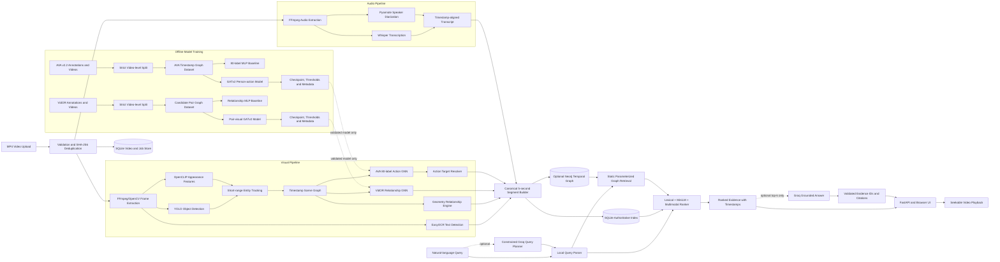
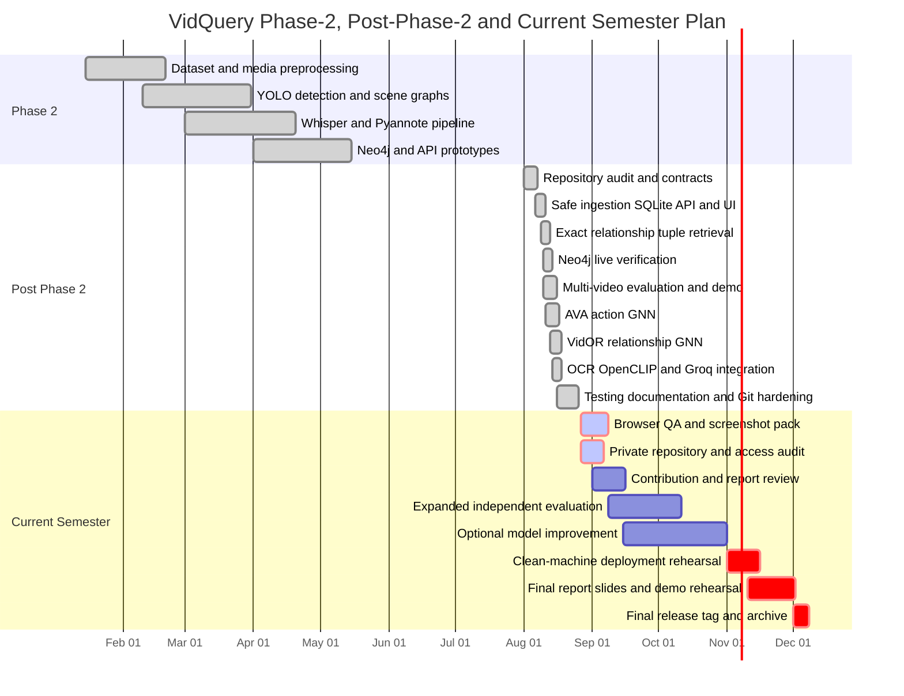

# VidQuery — Capstone Project Review

**Current repository state:** 27 August 2026  
**Project guide:** Dr. Nazmin Begum  
**Repository branch:** [0ri3nt/VidQuery — dev_aryaman](https://github.com/0ri3nt/VidQuery/tree/dev_aryaman)

---

## 1. Abstract and Scope of the Project

### Abstract

VidQuery is a multimodal video-search system that allows users to search long videos using natural-language queries and receive the most relevant video moments with timestamps. Unlike transcript-only video search, VidQuery combines spoken content, speakers, visual objects, OCR text, person-centric actions, and explicit relationships between entities.

When a video is uploaded, VidQuery validates and deduplicates the MP4, extracts frames and audio, runs YOLO object detection, Whisper transcription, Pyannote speaker diarization, OCR, appearance encoding, and learned action and relationship models. These outputs are aligned into canonical five-second segments and persisted in SQLite, with optional mirroring into Neo4j as a temporal knowledge graph.

At search time, a constrained query planner identifies transcript, entity, action, speaker, OCR, and relationship requirements. VidQuery performs lexical, MiniLM semantic, multimodal, and exact subject–predicate–object retrieval. An optional Groq grounded-answer layer summarizes only the retrieved evidence and attaches timestamp citations while preserving the original ranked results.

The system is intended for lecture archives, meetings, surveillance review, media analysis, and other scenarios where manually locating a specific event in a long video would be inefficient.

### Project scope

Implemented scope:

- MP4 upload, validation and SHA-256 deduplication.
- Frame and audio extraction.
- YOLO-based object detection.
- Whisper speech transcription.
- Mandatory Pyannote speaker diarization when audio is processed.
- EasyOCR text extraction.
- Temporal entity tracking and appearance features.
- Geometry-derived spatial relationships.
- AVA 80-label person-action GNN.
- VidOR-trained relationship GNN.
- Canonical five-second multimodal segments.
- SQLite persistence.
- Optional Neo4j temporal graph mirroring and parameterized retrieval.
- Lexical, semantic and multimodal retrieval.
- Exact relationship-tuple matching.
- Optional Groq query planning and grounded answer generation.
- FastAPI backend, browser UI, thumbnails and range-supported playback.
- Evaluation, testing and Docker deployment utilities.

Outside the current scope:

- Face recognition or automatic identification of real people.
- Arbitrary LLM-generated Cypher.
- A GNN that directly identifies the object target of every AVA action.
- Production-scale authentication, authorization and distributed job queues.
- Guaranteed recognition of objects outside a model’s supported classes.
- Claims of general state-of-the-art performance.

AVA GNN actions are person-centric. When an action requires another entity, a separate resolver selects the probable target and records the provenance as `gnn_action_plus_target_resolver`.

---

## 2. Architecture Diagram and Complete Pipeline



### Complete processing flow

1. **Upload and validation:** FastAPI receives an MP4, validates its format and computes a SHA-256 hash to prevent duplicate processing.
2. **Media extraction:** FFmpeg/OpenCV extract timestamped frames and audio.
3. **Visual understanding:** YOLO detects objects; OCR reads visible text; OpenCLIP produces appearance features; tracking links entities across nearby frames.
4. **Audio understanding:** Whisper produces timestamped speech, while Pyannote assigns speaker labels.
5. **Scene-graph construction:** Objects and people become nodes. Geometry and learned relations become directed or symmetric edges.
6. **Learned inference:** The AVA GNN predicts person-centric actions, and the VidOR GNN predicts explicit entity relationships.
7. **Temporal alignment:** All evidence is combined into canonical five-second segments.
8. **Persistence:** SQLite remains the authoritative local metadata and search store. Neo4j optionally mirrors graph evidence.
9. **Retrieval:** The query is converted into safe structured constraints and ranked using lexical, semantic, visual, action, speaker, OCR and exact relationship evidence.
10. **Output:** Results include timestamps, thumbnails, evidence chips, match explanations and seekable video playback. Groq optionally produces a grounded answer above the results.

There is currently no external queue such as Celery or Kafka. Processing uses application background tasks.

Important implementation files:

- `vidquery/media.py`
- `vidquery/models.py`
- `vidquery/ocr.py`
- `vidquery/appearance.py`
- `vidquery/tracking.py`
- `vidquery/relationships.py`
- `vidquery/segments.py`
- `vidquery/storage.py`
- `vidquery/neo4j.py`
- `vidquery/search.py`
- `vidquery/query_planner.py`
- `vidquery/ava_gnn80.py`
- `vidquery/ava_improved.py`
- `vidquery/vidor_relation.py`
- `vidquery/vidor_improved.py`
- `vidquery/rag.py`
- `vidquery/api.py`
- `vidquery/evaluation.py`
- `frontend/`

---

## 3. Summary of Capstone Project Phase–2 Work

Phase–2 established the experimental foundation of VidQuery.

Implemented during Phase–2:

- AVA annotation parsing.
- Frame and audio extraction.
- YOLO object detection.
- Whisper transcription.
- Pyannote speaker diarization.
- Heuristic frame-level scene-graph creation.
- Video and graph visualization utilities.
- Transcript and speaker alignment.
- Initial multimodal JSON outputs.
- GNN-compatible feature tensor export.
- Initial Neo4j schema and ingestion prototype.
- Minimal API and Streamlit-style interface prototypes.

Phase–2 limitations:

- The GNN had random weights and was not trained or validated.
- There was no canonical timestamp-segment contract.
- Retrieval did not enforce exact relationship tuples.
- Search ranking was limited and not independently evaluated.
- The LLM-to-Cypher prototype was unsafe because generated Cypher was insufficiently restricted.
- Neo4j had not been fully verified using live, repeatable ingestion.
- Upload state, persistence and video playback were incomplete.
- There were no automated pytest tests at the original Phase–2 baseline.
- There was no complete reproducible Docker workflow.

The post-Phase–2 work transformed these prototypes into an integrated, testable vertical slice. The detailed baseline audit is available in [`docs/IMPLEMENTATION_AUDIT.md`](IMPLEMENTATION_AUDIT.md).

---

## 4. Modules Developed Post Phase–2

| Module | Development completed | Main output |
|---|---|---|
| Safe ingestion | MP4 validation, size checks, FFprobe verification, SHA-256 deduplication and persistent job states | Reliable `video_id`, upload status and processing state |
| Canonical segments | Unified visual, speech, speaker, OCR, action and relationship evidence into five-second windows | Stable segment records used by every retrieval backend |
| Object detection | Integrated configurable YOLO inference into normal video processing | Entity classes, bounding boxes, confidence and timestamps |
| Speech and diarization | Integrated Whisper and required Pyannote execution, including failure reporting | Timestamped transcript and speaker labels |
| OCR | Added EasyOCR evidence with confidence and timestamp alignment | Searchable visible text |
| Tracking and appearance | Short-range entity tracks plus frozen OpenCLIP crop embeddings | More consistent entities and visual similarity evidence |
| Exact relationship engine | Canonical tuples containing source ID/class, predicate, target ID/class, direction, confidence and method | Correct subject–predicate–object matching |
| AVA action GNN | Trained 80-label GATv2 person-action model with video-level splits and class thresholds | Searchable learned action predictions |
| Target resolver | Resolves another person/object for actions such as `talk_to` when possible | Explicit derived relation with separate provenance |
| VidOR relationship GNN | Trained pair-visual GATv2 relation classifier | Learned explicit entity-to-entity predicates |
| SQLite persistence | Durable videos, jobs, segments, evidence and search metadata | Authoritative local retrieval store |
| Neo4j integration | Constraints, indexes, idempotent ingestion and safe parameterized graph search | Optional graph candidates and tuple retrieval |
| Query planning | Local parsing plus optional Groq constrained planning | Allowlisted transcript/entity/action/speaker/OCR/relation constraints |
| Hybrid retrieval | Lexical, MiniLM semantic, multimodal and graph-aware ranking | Ranked timestamped moments with match reasons |
| Grounded RAG | Groq summarizes only the top retrieved evidence and must cite valid evidence IDs | Supported/unsupported answer with timestamp citations |
| API and UI | FastAPI endpoints, packaged browser UI, library, filters, thumbnails and video seeking | End-to-end user-facing search application |
| Evaluation | Independent multi-video corpus, baseline modes, category/video reports and latency measurement | Reproducible JSON metrics |
| Deployment and QA | Docker Compose, health reporting, HTTP QA and automated tests | Reproducible backend/Neo4j execution |

### Exact relation matching example

Stored edge:

```text
person_1 --near--> chair_4
```

The following query matches:

```json
{
  "subject": "person",
  "predicate": "near",
  "object": "chair"
}
```

These do not match:

```text
person_1 --near--> table_2
chair_4 --left_of--> person_1
```

`near` and `overlaps_with` are symmetric. `left_of`, `right_of`, `above`, `below`, `inside` and `contains` remain directional.

---

## 5. Demo, Results and Outputs

### Recommended demonstration workflow

Start the application:

```powershell
python -m vidquery serve --host 127.0.0.1 --port 8000
```

Open:

```text
http://127.0.0.1:8000
```

Recommended demonstration:

1. Show `/api/health` and explain configured models.
2. Upload or select the controlled demo video.
3. Search for speech: `Find where architecture is discussed`.
4. Search for an exact relationship: `Find a person near a laptop`.
5. Search multimodally: `Find where deployment is discussed while a laptop is visible`.
6. Search by speaker: `Find where SPEAKER_01 discusses architecture`.
7. Search by action: `Find a person writing`.
8. Show Groq’s grounded answer and click its timestamp citation.
9. Keep the raw ranked results visible and seek the video.
10. Optionally show corresponding Neo4j entities and relationships.

The controlled demo manifest is available at [`demo/final_demo_manifest.json`](../demo/final_demo_manifest.json), with instructions in [`docs/FINAL_DEMO_GUIDE.md`](FINAL_DEMO_GUIDE.md).

### Module evidence and output files

| Module | Evidence/output |
|---|---|
| Full application | [`FINAL_CAPSTONE_EVIDENCE.md`](FINAL_CAPSTONE_EVIDENCE.md) |
| AVA GNN | [`AVA80_GNN.md`](AVA80_GNN.md) |
| Current learned-model status | [`GNN_STATUS.md`](GNN_STATUS.md) |
| Model limitations | [`MODEL_LIMITATIONS.md`](MODEL_LIMITATIONS.md) |
| Neo4j verification | [`NEO4J_VERIFICATION.md`](NEO4J_VERIFICATION.md) |
| Multi-video evaluation | [`EVALUATION_FINAL.md`](EVALUATION_FINAL.md) |
| UI/API QA | [`UI_QA.md`](UI_QA.md) |
| Machine-readable retrieval output | [`evaluation/results/independent-final.json`](../evaluation/results/independent-final.json) |
| Held-out action metrics | [`data/app/models/ava80/held_out_metrics.json`](../data/app/models/ava80/held_out_metrics.json) |
| Controlled demo image | [`data/demo/source/meeting_scene.png`](../data/demo/source/meeting_scene.png) |

### Screenshot requirement

A controllable Chrome/Edge session was unavailable during this report pass, so UI screenshots must not be presented as already verified. Capture and commit the following before submission:

| Filename | Screen to capture |
|---|---|
| `01-health.png` | `/api/health` with all model statuses |
| `02-upload.png` | MP4 upload screen |
| `03-library-ready.png` | Video in `READY` state |
| `04-transcript-search.png` | Architecture transcript query |
| `05-exact-relationship.png` | `person near laptop` with tuple evidence |
| `06-speaker-ocr.png` | Speaker or OCR query |
| `07-gnn-action.png` | Action result with `gnn_action_model` evidence |
| `08-grounded-answer.png` | Groq answer, timestamp citations and raw results |
| `09-player-seek.png` | Video player seeking to the cited timestamp |
| `10-neo4j.png` | Neo4j schema/count/query result |
| `11-test-results.png` | Terminal showing the passing test suite |

Place screenshots under `docs/screenshots/` and reference them from the final report.

---

## 6. Performance Metrics and Baseline Comparison

### Independent retrieval corpus

The final independent evaluation contains:

- 62 queries.
- 5 videos.
- 52 positive queries.
- 10 negative queries.
- Transcript, visual, relationship, action, speaker, multimodal, OCR and negative categories.

### Overall retrieval comparison

| Retrieval method | P@1 | P@5 | Recall@5 | MRR | Timestamp accuracy | Mean latency |
|---|---:|---:|---:|---:|---:|---:|
| Transcript lexical baseline | 0.4231 | 0.0885 | 0.3462 | 0.4231 | 0.4231 | 98.45 ms |
| Transcript semantic MiniLM | 0.5000 | 0.1885 | 0.4692 | 0.5000 | 0.5000 | 9.04 ms |
| Visual entity retrieval | 0.3462 | 0.3500 | 0.3617 | 0.4109 | 0.5192 | 93.14 ms |
| Hybrid without exact tuples | 0.9615 | 0.5692 | 0.7706 | 0.9615 | 0.9615 | 105.16 ms |
| **Exact local hybrid** | **0.9615** | **0.5769** | **0.7738** | **0.9615** | **0.9615** | 106.78 ms |
| Neo4j exact graph retrieval | 0.8654 | 0.5462 | 0.6776 | 0.8654 | 0.8654 | 128.74 ms |

The exact local hybrid significantly outperformed the transcript-only baselines on this controlled corpus. Exact relationship tuples improved P@5 and Recall@5 over the tuple-ablated hybrid while preventing semantically incorrect relation matches.

This is a project-corpus result, not a claim of general superiority across arbitrary videos.

### Exact relationship-query slice

| Method | P@1 | P@5 | Recall@5 | MRR |
|---|---:|---:|---:|---:|
| Tuple-ablated hybrid | 1.0000 | 0.9500 | 0.6553 | 1.0000 |
| **Exact local tuple retrieval** | **1.0000** | **1.0000** | **0.6757** | **1.0000** |
| Neo4j exact retrieval | 1.0000 | 1.0000 | 0.6757 | 1.0000 |

### AVA person-action model comparison

| Model | Labels | Held-out macro F1 | Held-out micro F1 | Held-out mAP |
|---|---:|---:|---:|---:|
| Historical MLP baseline | 80 | 0.0318 | 0.2431 | **0.1147** |
| Active GATv2, ROI + frame context | 80 | **0.0721** | **0.4621** | 0.0867 |

Interpretation:

- The GNN improved macro and micro F1 over the historical 80-label MLP.
- The MLP produced the higher held-out mAP.
- Therefore, the safe claim is that graph context improved thresholded F1 in this experiment—not that the GNN dominates every metric.
- A historical six-label MLP result must not be directly compared with the 80-label task because the label spaces differ.

AVA coverage represented in the current training artifacts:

- Official annotation map: 80 classes.
- Official statistics: 299 videos and 426,346 annotated persons.
- Current trained subset: 30 videos.
- Strict video-level split: 24 training, 3 validation and 3 test videos.
- 23,200 timestamp graphs.
- 68,565 nodes.
- 43,747 person nodes.
- No frame from one video appears in another split.

### VidOR relationship-model comparison

| Model | Validation macro F1 | Test macro F1 | Test micro F1 | Test mAP |
|---|---:|---:|---:|---:|
| Original relationship MLP | 0.2596 | 0.1613 | 0.3264 | 0.1897 |
| Original GATv2 | 0.2408 | 0.1785 | 0.3296 | 0.2034 |
| Pair-visual MLP | 0.2706 | **0.1825** | 0.3193 | **0.2107** |
| **Pair-visual GATv2** | **0.3085** | 0.1782 | **0.3711** | 0.1914 |

The pair-visual GATv2 was selected using validation metrics. The held-out test contains only four videos, so no broad claim of GNN superiority should be made.

### Neo4j verification

Historical live verification used Neo4j 5.26 Community:

- 13 constraints.
- 22 indexes.
- 334 segments across the initial two-video verification.
- 2,254 entity occurrences.
- 12,796 relationship-evidence records.
- Re-ingestion produced identical counts, demonstrating idempotency.

At the latest local health check, the application and SQLite were healthy, but Neo4j was not running. Start it before the final demo:

```powershell
docker compose up -d neo4j
```

### Software quality

The latest repository verification recorded:

- 153 passing Python tests.
- 1 Neo4j integration test skipped when Neo4j was unavailable.
- Ruff passing.
- Mypy passing across 63 source files.
- Python compilation checks passing.
- Frontend JavaScript syntax checks passing.

---

## 7. Contribution of Each Team Member

This table is based on Git attribution and should be confirmed by all team members before submission.

| Team member | Repository-evidenced contribution |
|---|---|
| **Agnivesh Singh — PES2UG23CS034** | Phase–2 frame extraction, YOLO detection, scene-graph construction, dataset download tooling and graph/video visualization |
| **Abhishrut Kaushik — PES2UG23CS023** | Whisper transcription, Pyannote diarization, audio-pipeline artifacts and video-visualization improvements |
| **Aryaman Singh — PES2UG23CS097** | Integrated package architecture and post-Phase–2 vertical slice: canonical segments, persistence, API/UI, retrieval, exact tuples, Neo4j integration, GNN training/inference, evaluation, Groq integration and repository hardening |
| **Rushad Khoja — PES2UG23AM061** | No separately attributed commit was found in the current repository history. Add only team-confirmed work such as evaluation, literature review, documentation, dataset preparation, QA or presentation development |

Git commit authorship is not necessarily the complete academic contribution record. Use meeting notes, experiment logs and submitted documents to confirm non-code contributions.

---

## 8. Remaining Modules and Work

### Essential work before final review

1. Complete manual Chrome and Edge/Firefox QA.
2. Capture and commit the screenshot pack.
3. Start Neo4j and repeat the live idempotency and graph-search proof.
4. Rehearse the complete demo from a clean environment.
5. Verify that the GitHub repository is private.
6. Invite only the four team members and the project guide.
7. Finalize the team-contribution table with team-approved evidence.
8. Package trained checkpoints securely; large model binaries should remain outside normal Git history.
9. Finalize the report, presentation and claim boundaries.
10. Tag the final reproducible commit.

### Research extensions

- Train AVA and VidOR models on larger video subsets.
- Add stronger temporal video features instead of mostly frame-level context.
- Improve long-range tracking.
- Add confidence intervals and multi-annotator ground truth.
- Add production authentication, object storage and a durable task queue.
- Evaluate on a larger external corpus.

---

## 9. Gantt Chart

The following schedule assumes the current semester runs from August to December 2026. Dates should be adjusted if the university calendar differs.



---

## 10. GitHub Repository

Repository:

[https://github.com/0ri3nt/VidQuery/tree/dev_aryaman](https://github.com/0ri3nt/VidQuery/tree/dev_aryaman)

Current pushed commit:

```text
d81a80f5ea0f3067513a1eb384bc1ed8019f0e5b
```

The repository’s privacy status has not been independently verified. Before including it in the report:

1. Open repository **Settings → General → Danger Zone**.
2. Confirm visibility is **Private**.
3. Open **Settings → Collaborators**.
4. Add only the team members and Dr. Nazmin Begum.
5. Enable branch protection for the submission branch.
6. Confirm `.env`, API keys, Hugging Face tokens, Groq keys, raw databases and large checkpoints are not tracked.

The repository contains the code and database schema. Runtime SQLite databases and model checkpoints should be generated or mounted from private storage rather than committed. The Neo4j schema is in [`database/schema.cypher`](../database/schema.cypher).

---

## 11. References in IEEE Format

[1] C. Gu *et al.*, “AVA: A video dataset of spatio-temporally localized atomic visual actions,” in *Proc. IEEE/CVF Conf. Computer Vision and Pattern Recognition*, 2018, pp. 6047–6056, doi: 10.1109/CVPR.2018.00633. [Online]. Available: [CVF Open Access](https://openaccess.thecvf.com/content_cvpr_2018/html/Gu_AVA_A_Video_CVPR_2018_paper.html)

[2] X. Shang, D. Di, J. Xiao, Y. Cao, X. Yang, and T.-S. Chua, “Annotating objects and relations in user-generated videos,” in *Proc. ACM Int. Conf. Multimedia Retrieval*, 2019, pp. 279–287. [Online]. Available: [VidOR project](https://xdshang.github.io/docs/vidor.html)

[3] J. Redmon, S. Divvala, R. Girshick, and A. Farhadi, “You only look once: Unified, real-time object detection,” in *Proc. IEEE Conf. Computer Vision and Pattern Recognition*, 2016, pp. 779–788, doi: 10.1109/CVPR.2016.91. [Online]. Available: [CVF paper](https://www.cv-foundation.org/openaccess/content_cvpr_2016/papers/Redmon_You_Only_Look_CVPR_2016_paper.pdf)

[4] A. Radford *et al.*, “Robust speech recognition via large-scale weak supervision,” *arXiv preprint arXiv:2212.04356*, 2022. [Online]. Available: [arXiv](https://arxiv.org/abs/2212.04356)

[5] H. Bredin *et al.*, “pyannote.audio: Neural building blocks for speaker diarization,” in *Proc. IEEE Int. Conf. Acoustics, Speech and Signal Processing*, 2020, pp. 7124–7128, doi: 10.1109/ICASSP40776.2020.9052974.

[6] S. Brody, U. Alon, and E. Yahav, “How attentive are graph attention networks?” in *Proc. International Conference on Learning Representations*, 2022. [Online]. Available: [OpenReview](https://openreview.net/forum?id=F72ximsx7C1)

[7] A. Radford *et al.*, “Learning transferable visual models from natural language supervision,” in *Proc. International Conference on Machine Learning*, vol. 139, 2021, pp. 8748–8763. [Online]. Available: [PMLR](https://proceedings.mlr.press/v139/radford21a.html)

[8] W. Wang *et al.*, “MiniLM: Deep self-attention distillation for task-agnostic compression of pre-trained transformers,” in *Advances in Neural Information Processing Systems*, vol. 33, 2020. [Online]. Available: [NeurIPS](https://proceedings.neurips.cc/paper/2020/hash/3f5ee243547dee91fbd053c1c4a845aa-Abstract.html)

[9] N. Reimers and I. Gurevych, “Sentence-BERT: Sentence embeddings using Siamese BERT-networks,” in *Proc. EMNLP-IJCNLP*, 2019, pp. 3982–3992, doi: 10.18653/v1/D19-1410. [Online]. Available: [ACL Anthology](https://aclanthology.org/D19-1410/)

[10] P. Lewis *et al.*, “Retrieval-augmented generation for knowledge-intensive NLP tasks,” in *Advances in Neural Information Processing Systems*, vol. 33, 2020. [Online]. Available: [NeurIPS paper](https://proceedings.neurips.cc/paper/2020/hash/6b493230205f780e1bc26945df7481e5-Paper.pdf)
