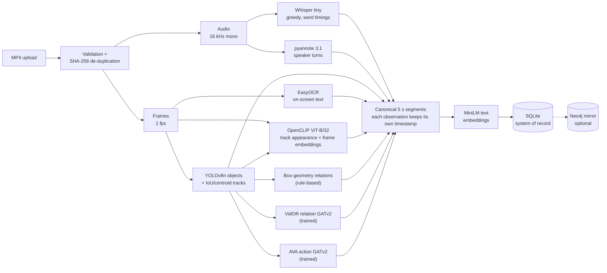
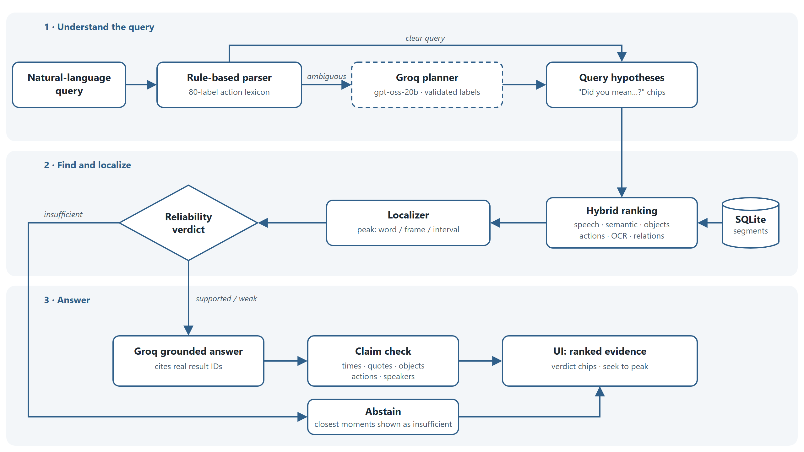

# VidQuery — Review 3 slides (updated content, 27 Oct 2026)

Copy each slide's text into the deck. Diagrams are Mermaid: paste the code into
https://mermaid.live and export PNG/SVG. Lines in *[square brackets, italics]* are notes for you, not slide text.

## What changed vs the current deck

| Old slide | Change |
|---|---|
| 3 + 4 | Merged into one "Abstract and Scope" slide (outline allows 1); scope now states boundaries |
| 5 | Covers Review 1 **and** Review 2 (Review-2 rows need your input) |
| 6 | Diagram redrawn; "Exact multimodal retrieval" → "Hybrid ranking" |
| 7 | Old "Methodology" diagram replaced by the search-time flow |
| 8 | Speakers are assigned per utterance, not per word |
| 10 | Parser recall marked as in-sample; thresholds are fixed constants, not fitted; Groq answer checks added |
| 11 | `.env` claim corrected; full API route names |
| 12 | Demo slide filled in, with disclosures and a backup plan |
| 13 | Test counts updated (43 modules, 506 passed, mypy 10); no CI |
| 15 + 16 | Merged into one results slide; VidOR MLP row added; +0.048 → +0.047 |
| 17 + 18 + 19 | Merged into one results slide; spans labelled; +0.318 replaced by a same-span +0.272 [0.236, 0.311]; ablations no longer "pending"; Table D uses the integrated index only |
| 20 | Timeline cut (not in the outline); status folded into the conclusion |
| 21 + 22 | Conclusion, limitations and **future work** on one slide (future work was missing) |
| 23 | References completed for every tool named on the slides |

Deck: 18 slides (title, outline, 15 content slides including references, thank you), down from 24.

---

## Slide 1 — Title

*[Unchanged.]*

---

## Slide 2 — Outline

- Abstract and Scope
- Suggestions from Review 1 & 2
- Pipeline and Architecture
- Implementation Details
- Project Demonstration
- Test Plan and Strategy
- Results and Discussion
- Conclusion and Future Work
- References

---

## Slide 3 — Abstract and Scope

**Abstract**
- VidQuery: natural-language search over a video library that jumps to the exact moment
- Combines speech (Whisper, pyannote), vision (YOLOv8n, OpenCLIP, EasyOCR) and learned graph models (AVA actions, VidOR relations) in one timestamped index
- Every result shows its evidence and a verdict (supported / weak / insufficient); the system abstains when the evidence is not enough

**Problem**
- Hours of meetings, lectures and recordings; keyword or transcript search cannot see slides, speakers or what people do

**Scope**
- Input: MP4 uploads, processed locally (SQLite store; Neo4j optional)
- Understands: speech and speaker turns, on-screen text, 80 COCO object classes, 80 AVA person actions, 50 VidOR relations
- Evaluated on: Charades-STA / NA-VMR household videos, AVA movie clips, VidOR
- Out of scope so far: lecture-video benchmark, live streams

---

## Slide 4 — Suggestions from Review 1 & 2

| Review | Suggestion | What we did |
|---|---|---|
| Review 1 | Timestamps were coarse (fixed 5 s windows) | Coarse-to-fine localization down to the word or frame |
| Review 1 | Ambiguous queries gave mixed results | Ambiguity-aware hypotheses with a "Did you mean…?" prompt |
| Review 1 | Weak action/relation models were treated as fact | Reliability-weighted verdicts; abstain when evidence is weak |
| Review 1 | Benchmark saturated (P@1 0.96, labelled evidence) | End-to-end benchmark on raw video (Charades-STA + NA-VMR) with negatives |
| Review 2 | *[fill in: panel suggestion]* | *[fill in]* |
| Review 2 | *[fill in: panel suggestion]* | *[fill in]* |

*[The repo has no record of the panels' words. Confirm the Review-1 rows, and add Review-2 suggestions. Work done after the new models, which you can map to them:
AVA 24 → 94 and VidOR 400 → 1,900 training videos; deterministic Whisper; full ablations;
Groq answer verification; speaker-attribution fix.]*

---

## Slide 5 — System pipeline (indexing)

- 7 extractors, 2 of them trained by us (AVA actions, VidOR relations); both GNNs run on the YOLO person/object boxes before alignment
- All evidence is aligned into 5 s segments, then embedded with MiniLM and stored
- Each observation keeps its source, confidence, timestamp and model version
- Optional components degrade with a warning; checkpoints load only if their SHA-256 matches

---

## Slide 6 — Search-time flow

*[Use the ready-made 16:9 image: `search_flow_16x9.png` (2560×1440) or `search_flow_16x9.svg` (editable, sharp at any size) in this folder. Insert → Pictures, then stretch to the slide edges.]*

- Groq is consulted only for ambiguous queries; if it is unavailable, the local parser is used and the UI says so
- An answer that claims anything the cited evidence does not show is rejected

---

## Slide 7 — Ingestion and multimodal extraction

**Turning a video into searchable evidence**: every upload is split into pictures and sound, and several AI models describe them

- **Upload:** the video is checked, duplicates are detected, and progress is shown step by step until it is ready
- **What is seen:**
  - Objects and people in each frame (YOLOv8n), followed from frame to frame
  - Text written on screen, such as slides (EasyOCR)
  - What things look like, e.g. colours and clothing (OpenCLIP)
- **What is heard:**
  - Speech turned into text, with the time of every word (Whisper)
  - Who is speaking, e.g. Speaker 1 or Speaker 2 (pyannote)
- **Meaning of the text:** each piece of text is turned into numbers so similar meanings can be matched (MiniLM)
- **Robust:** if an optional model fails, the video is still indexed and a warning is shown
- **Repeatable:** the same video now always gives the same transcript (40 of 40 test clips, up from 17 of 40)

*[Speaker notes. Frames are taken once per second and audio at 16 kHz. Processing states: UPLOADED →
PREPROCESSING → VISUAL → AUDIO → SCENE_GRAPH → ALIGNING → INDEXING → READY / FAILED. Tracking links a box
to the next frame by overlap (IoU) and centre distance. Speakers are matched to each spoken sentence by
largest time overlap. Repeatability: Whisper's default retried with random sampling, so we switched to
greedy decoding at temperature 0; two full rebuilds of 20 videos then matched in all 131 segments.
Models load only when first needed, so the server starts fast; an untrained action/relation model is
never used.]*

---

## Slide 8 — Learned graph models

**We trained two graph neural networks (GNNs)**: each video frame becomes a small graph of people and objects

- **Action model (AVA):** recognises what each person is doing, from 80 actions (sit, stand, talk to, hold an object, …)
  - Looks at each person's position, the objects around them, and image features from a pretrained ResNet-18
- **Relation model (VidOR):** recognises how two objects relate, from 50 relations (next to, in front of, holding, …)
  - Trained on true pairs plus look-alike wrong pairs, so it learns to tell them apart
- **Fixing a data leak (v7 / v8):**
  - Old training data marked which person boxes came from human labels; real videos never carry that mark
  - The model could use that shortcut instead of learning the action, so we removed it
  - v7 = first leak-free model; v8 = same fix, trained on 4× more videos
- **More training data:** AVA 24 → 94 videos; VidOR 400 → 1,900 videos (test videos never used for training)
- **Fair comparison:** each GNN is compared with a simpler network (MLP) given the same inputs
- **Safety:** a model loads only if its file fingerprint matches what was tested

*[Speaker notes. Leak, in detail: person boxes that YOLO missed were added from the ground truth with a
flag `annotation_only = 1` and `detector_confidence = 0`. Those boxes are always labelled people, so the
flag gave the answer away; at deployment the flag is always 0. It affected 7.1% of training, 5.0% of
validation and 2.5% of test labels (`docs/AUDIT_2026-10.md`). "Graph" = nodes are the person/object boxes,
edges carry their relative position; GATv2 = graph attention, which lets each person weigh nearby
objects. If asked: the action model uses two GATv2 layers; decoding uses per-action thresholds chosen on
validation; the fingerprint is a SHA-256 hash.]*

---

## Slide 9 — Query understanding, search and answers

**From a question to the right moment**: how a search is answered

- **Understanding the question:** a rule-based parser picks out objects, actions, speakers and spoken words
  - Knows all 80 actions in many forms (sit, sits, sitting…); this raised accuracy on unseen test questions from 12% to 27%
  - Unclear wording goes to an AI planner (Groq), which may only use labels the system knows
- **Ranking:** each 5-second segment is scored on everything that matches: speech, meaning, objects, actions, on-screen text, appearance and relations
- **Pinpointing the moment:** inside the best segment, the system finds the exact second (down to the spoken word or frame)
- **How sure are we?** every result is labelled *supported*, *weak* or *insufficient*; when the evidence is insufficient, the system says so instead of guessing
- **Written answer:** an AI writes a short answer using only the retrieved results, and every time, quote and object it mentions is checked
- **Optional extras (off by default):** partial matching, picture-to-text similarity, and sound-alike word matching

*[Speaker notes. Accuracy = P@1 on 56 untouched AVA test queries, 0.122 → 0.268 [0.15, 0.41]. Verdict
thresholds: supported ≥ 0.45, weak ≥ 0.15, below that insufficient; they are fixed design values, not
learned. Localization precision order: word > frame > interval > utterance > segment. Groq model:
gpt-oss-20b. The written answer must cite real result IDs; any claim not backed by the cited evidence is
rejected, and the answer states which video and moment. "Partial matching" = soft constraints;
"picture-to-text" = frame-level OpenCLIP similarity; both were used for the Charades results.]*

---

## Slide 10 — Storage, API, interface, reproducibility

**Storing results and using the system**

- **Storage:** everything is kept in a single local database (SQLite); a graph database (Neo4j) can mirror it but is optional
- **Web API:** the browser talks to the server through a small set of web addresses
  - Upload or delete a video, check its progress, run a search, stream or preview the video, check system health
- **Browser interface:**
  - Library of videos, search box, "Did you mean…?" chips, confidence labels
  - Clicking a result plays the video from the exact moment
  - An Annotate tab for labelling test questions
- **Safe experiments:** new models are tried as temporary settings; the live setup changes only after approval, with a backup
- **Reproducible results:** every experiment writes to its own new folder, never overwrites old results, uses a fixed random seed, and records file fingerprints

*[Speaker notes. Endpoints: POST /api/videos (upload), POST /api/videos/{id}/process, DELETE
/api/videos/{id}, GET /api/videos/{id}/status, POST /api/search, /stream (byte-range playback),
/thumbnail, /api/health, plus annotation endpoints. Neo4j writes use MERGE, so re-sending the same video
never creates duplicates; it is off locally. Seed 2026; fingerprints are SHA-256 hashes of manifests,
checkpoints and data shards; long jobs can resume after interruption.]*

---

## Slide 11 — Project demonstration

**Demo library:** 3 Charades household videos + 1 recorded talk; experimental search settings on (soft constraints + frame similarity)

| # | Query | Video | Expected |
|---|---|---|---|
| 1 | person drinking from a cup. | OM2NF | 15–20 s, peak 16.0 s, **supported** |
| 2 | person sitting on the bed. | I2DHG | 25–30 s, peak 25.0 s, **supported** |
| 3 | a person is watching television on the sofa. | GG4UR | 0–5 s, peak 1.0 s, **supported** |
| 4 | Find where architecture is discussed | Untitled design.mp4 | 10–15 s, peak 11.7 s, **supported**, with a grounded answer that names the moment |
| 5 | A sparrowhawk chases a small bird through a dense forest. | any | **insufficient**, so it abstains |
| 6 | person vacuuming the floor. | OM2NF | **weak**, not rejected (known limitation) |

- Shows: upload and processing states, search, seek to peak, verdicts, abstention, provenance
- Real model output on the Charades videos; `final_demo.mp4` (if shown) uses hand-labelled evidence, and we say so on screen
- Backup: a pre-recorded demo video (Groq's free tier allows 200k tokens/day; answers show "Groq unavailable" when it runs out)

*[Expected values verified 26 Oct; re-run `verify_demo_library.py` before the review. Rehearse "find drive" separately if you want to show the hypothesis chips.]*

---

## Slide 12 — Software testing

- **Automated tests:** 43 test modules; latest run **506 passed, 1 skipped** (live Neo4j test needs a running server); ruff clean
- **Unit tests:** parser and lexicon (130 tests), reliability, localization, OCR, tracking, geometry, phonetics, Whisper options, checkpoint schema checks, bootstrap metrics, Groq answer verification
- **Integration tests:** media pipeline through the API, search and storage, shard round-trips, frozen-test VidOR invariant, profile launcher
- **Regression tests from real failures:** Groq answers recorded live are replayed offline, so tests never spend API quota
- **Reproducibility checks:** deterministic Whisper (40/40); two rebuilds identical (131/131 segments)
- **Safeguards:** versioned outputs, recorded hashes, resumable jobs, logged runtime and RAM/disk use
- **Tools:** pytest, ruff, mypy (10 pre-existing type errors); no CI pipeline yet; tests run locally

---

## Slide 13 — Evaluation strategy

| Task | Data | Train / val / test |
|---|---|---|
| AVA action classification | AVA v2.2 | 94 / 3 / 6 videos; 10,459 test persons |
| VidOR relation classification | VidOR | 1,900 / 50 / 50 videos; 8,725 test edges |
| Moment retrieval + answerability | Charades-STA + NA-VMR | no training; val 150 videos; test 300 videos (863 positives, 863 in-domain + 855 out-of-domain negatives) |
| AVA end-to-end queries | 3 untouched AVA videos | 56 queries (41 positive / 15 negative) |

- **Rule:** models and thresholds are chosen on validation, written to a decision file, then test is scored once
- **Statistics:** paired bootstrap 95% CIs over videos (2,000 resamples); a gain is claimed only if the CI excludes 0
- **Metrics:** macro F1 / mAP / micro F1; P@1, R@1 at tIoU 0.5 / 0.7, R@5; rejection rate, rejection F1, AUROC

---

## Slide 14 — Results 1: model classification

**More training data made both of our trained models better**

**Table A — Recognising 80 person actions (AVA, 6 unseen test videos)**

| Model | Training videos | Macro F1 | mAP |
|---|---:|---:|---:|
| Earlier graph model | 24 | 0.073 | 0.071 |
| **Current graph model (v8, used)** | **94** | **0.088** | **0.089** |
| Simpler network, same inputs | 94 | 0.086 | 0.088 |

*In simple words:* training on about 4× more videos made the action model better, and the improvement is
statistically real. A simpler network given the same information does about as well, so the gain comes
from more data. The scores look small because there are 80 actions and many are rare; every action
counts equally in this score.

**Table B — Recognising 50 object relations (VidOR, 50 unseen test videos)**

| Model | Training videos | Macro F1 | mAP |
|---|---:|---:|---:|
| Earlier graph model (v3) | 400 | 0.171 | 0.187 |
| **Current graph model (v4, used)** | **1,900** | **0.218** | **0.242** |
| Simpler network, same inputs | 1,900 | 0.233 | 0.239 |

*In simple words:* almost 5× more training videos raised the relation score by about a quarter
(0.171 → 0.218), again a real improvement. The graph model and the simpler network are statistically tied.

*[Chart alternative: `classification_results.png` shows the same results as bars.]*

*[Speaker notes, for questions.
"Why use GAT v4 if the MLP scores 0.233?" (1) We choose models on the validation videos, before
looking at test: there GAT v4 scored 0.288 and the MLP 0.287. (2) On test the difference, +0.015
[−0.011, 0.032], is not statistically significant, and GAT has the higher mAP. (3) VidQuery's runtime
loads graph-model checkpoints, so GAT was the model the pipeline could use. (A warm-started MLP variant
scored 0.292 on validation, the best overall, but the runtime cannot load MLP checkpoints.) Supporting MLP
checkpoints is easy future work.
"Why show the simpler network at all?" It is a fairness check: same inputs, no graph.
"Is the improvement real?" Paired bootstrap 95% CIs exclude zero: AVA +0.015 [0.011, 0.020] vs the
earlier model; VidOR +0.047 [0.015, 0.073] vs v3.
"Why is 0.088 so low?" Macro F1 averages all 80 actions equally; weighted by how often actions occur
(micro F1) it is 0.50, and common actions (sit, stand, talk) work best.
Other numbers if asked: AVA micro F1 earlier 0.507, v8 0.500, MLP 0.485; VidOR v2 (57 videos) macro F1
0.071; VidOR micro F1 v4 0.355 vs MLP 0.387.]*

---

## Slide 15 — Results 2: search and answerability

**Search design, not new models, drives retrieval; unrelated questions are refused**

**Table C — Finding the right moment (Charades-STA, 300 unseen videos, 863 questions)**

| Method | Top result correct (R@1) | Right moment in top 5 (R@5) |
|---|---:|---:|
| Guess by position only (ignores the video) | 0.269 | — |
| VidQuery, default (strict) settings | 0.133 | 0.366 |
| **VidQuery, selected settings (used in demo)** | **0.408** | **0.866** |

*In simple words:* with the selected settings, VidQuery's first answer is right about 4 times in 10, and
the right moment is in the top 5 almost 9 times in 10. That is three times the default settings and
clearly better than guessing from position alone. The settings were chosen on separate validation videos.

**Table D — Saying "not in this video" (NA-VMR, 1,718 questions with no answer)**

| Settings | Unrelated questions refused | Plausible-but-absent refused | Real questions answered |
|---|---:|---:|---:|
| **Selected (demo)** | **99.3%** | 0.8% | **99.1%** |
| Default (strict) | 99.2% | 60.3% | 50.4% |

*In simple words:* questions about things that cannot be in the video ("a sparrowhawk in a forest") are
almost always refused. Questions that *could* happen but didn't ("person vacuuming") are the hard case:
the demo settings still answer them, and strict settings refuse 60% of them but also stop answering half
of the real questions. This trade-off is our main open problem.

*[Chart alternative: `retrieval_results.png` shows the same results as bars.]*

*[Speaker notes, for questions.
"Selected settings" = partial matching + picture-to-text similarity, chosen on validation videos only.
Scored on a 10 s window around the predicted moment. Selected vs default, same window: R@1 +0.275
[0.238, 0.314]; P@1 0.132 → 0.404 [0.371, 0.437].
"Is the 10 s window fair?" It is an evaluation choice; with 5 s segments selected scores 0.255, default
0.087, a random segment 0.116. At the exact labelled span it is 0.118, so precise timing is the main gap.
"Did the new models improve search?" No significant change: AVA v8 +0.007 [−0.021, 0.033], VidOR v4
0.000 [−0.012, 0.011]; only 12 of 2,581 test questions involve object relations. In strict mode AVA v8
refuses 4.5 points more plausible-but-absent questions [2.0, 7.2].
AVA end-to-end (56 questions): 0.122 → 0.268 [0.15, 0.41] with the new action vocabulary (earlier v5
action model).]*

---

## Slide 16 — Conclusion and future work

**Conclusion**
- Working evidence-backed video search: 7 extractors, 2 trained GNNs, canonical index, hybrid search, localization, verdicts with abstention, grounded answers, API and UI
- Leakage-safe, reproducible evaluation on three task types, each with paired CIs
- Measured gains: retrieval design **+0.272 P@1** (same span); more training data **+0.016** AVA and **+0.047** VidOR macro F1; deterministic indexing removed rebuild noise
- Honest negatives: new models don't improve Charades retrieval; in the demo settings, plausible but absent queries are not rejected; action recognition quality is low

**Limitations**
- Single-frame CLIP can't see verbs or temporal order
- Retrieval numbers use experimental settings and 10 s scoring spans
- AVA has only 6 test videos; validation overestimates test (≈ 2× AVA, 0.05–0.07 macro F1 VidOR)
- YOLOv8n matches only 27.5% of VidOR relation instances

**Future work**
- Clip-level video–language model for verbs and temporal order
- Reject plausible-but-absent queries: an opt-in verdict fix already cuts in-domain false acceptance by 2.9 points [1.7, 4.2] on test (awaiting rollout)
- Stronger detector: YOLOv8s / v8m raise the relation ceiling to 34.7% / 38.3% (needs GNN retraining)
- Lecture-video benchmark (speech, OCR, phonetic matching) and a larger AVA test set

---

## Slide 17 — References

**Datasets**
1. C. Gu et al., "AVA: A video dataset of spatio-temporally localized atomic visual actions," CVPR 2018, arXiv:1705.08421.
2. X. Shang, D. Di, J. Xiao, Y. Cao, X. Yang, T.-S. Chua, "Annotating objects and relations in user-generated videos," ACM ICMR 2019.
3. G. A. Sigurdsson et al., "Hollywood in homes: Crowdsourcing data collection for activity understanding," ECCV 2016, arXiv:1604.01753.
4. J. Gao, C. Sun, Z. Yang, R. Nevatia, "TALL: Temporal activity localization via language query," ICCV 2017, arXiv:1705.02101.
5. K. Flanagan, D. Damen, M. Wray, "Moment of untruth: Dealing with negative queries in video moment retrieval," WACV 2025, pp. 5336–5345, arXiv:2502.08544.

**Models and tools**

6. G. Jocher, A. Chaurasia, J. Qiu, "Ultralytics YOLOv8," software v8.0.0, 2023.
7. A. Radford et al., "Robust speech recognition via large-scale weak supervision," ICML 2023, arXiv:2212.04356.
8. H. Bredin et al., "pyannote.audio: Neural building blocks for speaker diarization," ICASSP 2020, arXiv:1911.01255.
9. A. Plaquet, H. Bredin, "Powerset multi-class cross entropy loss for neural speaker diarization," Interspeech 2023.
10. JaidedAI, "EasyOCR," software; Y. Baek et al., "Character region awareness for text detection," CVPR 2019, arXiv:1904.01941.
11. A. Radford et al., "Learning transferable visual models from natural language supervision," ICML 2021, arXiv:2103.00020.
12. M. Cherti et al., "Reproducible scaling laws for contrastive language-image learning," CVPR 2023, arXiv:2212.07143 (OpenCLIP).
13. N. Reimers, I. Gurevych, "Sentence-BERT: Sentence embeddings using Siamese BERT-networks," EMNLP-IJCNLP 2019, arXiv:1908.10084.
14. W. Wang et al., "MiniLM: Deep self-attention distillation for task-agnostic compression of pre-trained transformers," NeurIPS 2020, arXiv:2002.10957.
15. K. He, X. Zhang, S. Ren, J. Sun, "Deep residual learning for image recognition," CVPR 2016, arXiv:1512.03385.
16. S. Brody, U. Alon, E. Yahav, "How attentive are graph attention networks?" ICLR 2022, arXiv:2105.14491.
17. M. Fey, J. E. Lenssen, "Fast graph representation learning with PyTorch Geometric," ICLR 2019 Workshop, arXiv:1903.02428.
18. OpenAI, "gpt-oss-120b & gpt-oss-20b model card," 2025, arXiv:2508.10925 (used via the Groq API).

*[References 11–18 come from the 26 Oct draft; 5, 6, 9, 12 and 18 were web-checked then. Spot-check the rest before printing.]*

---

## Slide 18 — Thank You

*[Unchanged.]*

---

### Sources for every number (not for the slides)

| Slide | File |
|---|---|
| 14 | `evaluation/results/ava80-scale100-2026-10-26/test-comparison.json`; `evaluation/results/vidor-scale2000-2026-10-26/test-comparison.json`, `validation-decision.json` |
| 15 | `evaluation/results/charades-integrated-2026-10-26/det-ava8-vidor4/test-T{0,1}-*.json`; `comparison-test-T{0,1}-*.json`; `comparison-test-same-span-default-vs-selected.json` (computed 27 Oct); `evaluation/results/charades-2026-10-25/test/T1-selected-soft-frame.json` (baselines) |
| 15 (AVA) | `docs/EVALUATION_END_TO_END.md` (second round) |
| 16 | `docs/QUERY_QUALITY_FIXES_2026-10-27.md` (verdict fix); `docs/EVALUATION_END_TO_END.md` (detector recall) |
| 11 | `evaluation/results/demo-2026-10-26/demo-library-verification.json` |
| 7, 12 | `evaluation/results/whisper-determinism-2026-10-26/`; pytest/mypy run of 27 Oct |
